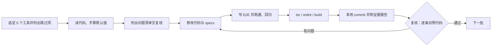

# Toolbox 工具页 (`/toolbox/[slug]`) 优化与验收标准 (Single Source of Truth)

> **适用范围**：`cadguide.tools` 下所有 `/toolbox/*` 页面（计算器、单位换算器、脚本/文件生成器、诊断向导、速查对照表）。
> 涉及文件：`src/app/toolbox/<slug>/calculator-client.tsx`、`src/app/toolbox/<slug>/page.tsx`、`src/components/decision-wizard-client.tsx`、`src/lib/toolbox-engineering-specs.json`、`src/lib/wizard-data/*`。
> **来源**：2026-11-04 ~ 11-05 两个 Agent（执行 + 复核）对前 15 个工具约十轮交叉审查的结果。任何 Agent 修改 toolbox 前必须先读本文件。

---

## 0. 总原则

1. **算得对优先于做得好看**。先保证公式、单位、换算系数正确，再谈交互和 UI。
2. **页面上每个数字都要能复算**。默认值、specs 算例、E2E 断言三者必须是同一组数，并且能用纸笔手算出来。
3. **标准、别名、版本号、注册表键只写能查到出处的**。查不到就删，不准猜，不准编。
4. **报告写的每一条都要附证据**。“已完成”必须附 `git show --stat` 或“文件路径 + 行号”。没改就说没改。
5. **范围透明**。跳过任何工具都要在报告里写明原因，不能悄悄漏掉。
6. **不扩大改动面**。只改本批工具；发现全站问题要如实记录为“已知问题，另行处理”，不能说成“已修复”。
8. **严禁在业务逻辑中为迎合测试“弄虚作假”**。测试报错必须追查测试环境或根本原因，绝不允许在 `catch` 块中谎报成功（例如：剪贴板写入失败时强行设为 `Copied!`），绝不允许清空输入时用 `|| 0` 加 `Math.max(1, ...)` 算出虚假应力掩盖空值。
9. **测试脚本必须纳入版本控制**。所有 E2E 测试脚本统一存放在 `tests/e2e/` 目录并提交进 Git，严禁存放在被 `.gitignore` 忽略的临时目录中。

---

## 1. 工具分类与各自的核心检查点

| 类型 | 例子 | 核心检查点 |
| :--- | :--- | :--- |
| 数值计算器 | ball-screw、ada-ramp、beam-deflection、bearing-capacity | 理论体系纯正不混用、公式与量纲严谨、默认值与算例手算闭环、空值优雅展示 `—`（绝无 NaN/NaN%）、导出 CSV |
| 单位换算器 | area-unit、angle-unit | 下拉选项与换算表 **一一对应**、使用精确定义系数、互换按钮 |
| 脚本/文件生成器 | registry-clean (.bat)、pgp-alias (.pgp) | 生成内容能真实运行、版本参数随选择变化、编码与特殊字符 |
| 诊断向导 | autocad-fatal-error-wizard | 每条原因有官方 KB 链接、数量描述与数据一致 |
| 速查/对照表 | autocad-vs-gstarcad-shortcuts、autocad-vs-zwcad-shortcuts | 字段概念清晰（Alias 列仅填纯快捷键，Command 列填完整命令）、每条数据有官方文档出处证据、彻底清除杜撰条目 |

---

## 2. 优化标准（修改时必须做到）

### 2.1 计算正确性
- 公式按教科书或标准写，注释里写出公式。**不同物理量不能混用**：
  - 例：喷嘴挤出轨迹长度 ≠ 1.75 mm 线材消耗长度，两者要分开显示；
  - 例：滚珠丝杠反向驱动要用反向效率 η₂，不能直接用正向效率 η₁。
- 换算系数使用 **精确定义值**（NIST SP 811），不用四舍五入后的近似值：
  - ft² = 0.09290304 m²，in² = 0.00064516 m²，yd² = 0.83612736 m²，acre = 4046.8564224 m²，ha = 10000 m²。
- **下拉框里的每个选项，在换算表里都必须有对应的键**。禁止 `map[key] || 1` 这类静默兜底，它曾经让公顷结果缩小 10,000 倍。
- 选型类工具补齐工程师实际需要的关键输出（如丝杠的线速度 v = n × lead ÷ 60）。

### 2.2 输入体验
- 数值输入用 **字符串 state**，计算放在 `useMemo` 里统一做 `parseFloat` 兜底。清空输入框时不能强制跳回 0 或 0.1。
- 输入为空或非法时，结果显示 `—`，**页面上任何位置都不得出现 `NaN`、`Infinity`、`undefined`**；单位符号照常显示。
- 常用工况提供预设按钮（如常用导程、常见坡道高度），并提供“Reset Defaults”。
- 换算器提供 From/To 互换按钮。

### 2.3 生成器（脚本/配置文件）
- `.bat` 内容 **只用纯 ASCII**（用 `[OK]`、`[WARN]` 代替 ✓、⚠），否则中文 Windows 的 cmd 会乱码。
- `echo` 行里不能出现未转义的 `<`、`>`、`|`、`&`；需要时写成 `^<`，或者改用 `PRODUCT_KEY` 这类占位符。
- 版本相关参数（注册表键 `R25.x`、`-pv 2026.0.0.F`）**必须随所选版本动态生成**，不能写死。
- 版本列表只保留已正式发布、能查到官方来源的版本（例：未经核实的 AutoCAD 2027 / R25.2 已删除）。
- 删除类操作前必须先备份（`reg export`），并在页面上写明需要管理员权限的选项。

### 2.4 别名、标准与引用的真实性
- CAD 别名以官方 `acad.pgp` / `gcad.pgp` / `zwcad.pgp` 为准。已确认清除的编造别名：`GWS`、`SPLAT`。
- `toolbox-engineering-specs.json` 中的 `standards` **只写和本工具直接相关、能查到编号的标准**。禁止套用其他工具的模板。已出现过的错误：
  - 注册表脚本被标成 NFPA 70 / IEEE 1584（电气）；
  - ADA 坡道被标成 ACI 318（混凝土）；
  - 诊断向导被标成 STEP/IFC/增材制造；
  - 杜撰了不存在的 “RepRap Standard Toolpath Slicing Kinematics”。
- `cadContext` 要写和本工具相关的 CAD 操作，不能写通用套话（如在 3D 打印工具里写 `$INSUNITS`、STEP 头）。
- 估算类结果要写明局限，并提示以专业软件或厂商样本为准（如“外壳体积为粗略估算，以切片软件为准”“效率以 THK/NSK/HIWIN 样本为准”）。

### 2.5 specs 数据一致性
- `toolbox-engineering-specs.json` 的 `inputs` 必须等于页面默认值，`outputs` 必须等于用默认值手算出的结果（保留位数与页面一致）。
- 描述性的数量（如“13 Documented Causes”）必须和数据文件实际条数一致，或者干脆不写数字。
- 页面 CSV 里引用的标准号要和 specs 保持一致（例：面积统一用 ISO 80000-3）。

### 2.6 可测试性
- 所有输入、按钮、关键结果都加 `data-testid`。命名规则：`input-*`、`select-*`、`btn-*`、`preset-*`、`result-*`、`badge-*`、`checkbox-*`。
- 结果数字放在单独的 `<span data-testid="result-...">` 里，单位放在外面，方便读取数值。

---

## 3. 验收标准（全部满足才算完成）

### 3.1 E2E 测试（Playwright，脚本放在 `tests/e2e/e2e_*.js`，严禁放在 gitignore 的 scratch 中）
每个工具至少包含：
1. **默认值手算断言**：在脚本注释里写出完整手算过程，相对误差 ≤ 1%（精确换算 ≤ 0.1%）。
2. **至少一组修改参数后的手算断言**，最好覆盖分支（如坡道高度超过 30 in 后出现中间平台）。
3. **数据内容断言**，不能只测“能点击”：如下拉选项列表、预设别名表、版本列表里不含未发布版本。
4. **空值/非法输入断言**：清空输入后页面不得出现 `NaN`。
5. **下载类断言**：用 `Promise.all([page.waitForEvent('download'), page.click(...)])` 拿到文件，读取文本内容，断言关键字段（标准号、表头、`reg export` 等）。
6. **生成器专项**：纯 ASCII 检查、特殊字符检查、切换版本后参数随之变化。
7. 断言要限定作用域（`data-testid` 容器内），不要用整页文本“碰巧包含”来判定通过。
8. 定位规则：全站 layout 已有一个 `<main>`，页面里不能再用 `locator('main')`，统一用 `getByRole('main').last()` 或 `data-testid`。
9. 页面导航用 `waitUntil: 'domcontentloaded'` 加 `waitForSelector`，不要用 `networkidle`（dev 服务器的 HMR 长连接会导致超时）。
10. 每批完成后，**之前所有批次的 E2E 都要回归跑一遍**。

### 3.2 静态检查与构建
按顺序执行，全部通过才能提交：
```powershell
npx tsc --noEmit                      # 0 errors
npx eslint <本批修改的文件>             # 0 errors（全项目 lint 有历史遗留错误，只检查本批文件）
node scratch/e2e_<本批>.js            # 全部 PASS
node scratch/e2e_<历史批次>.js         # 回归全部 PASS
npm run build                         # 成功；本地构建会自动跳过 IndexNow 提交
```
小范围复修（只改几行）可以不重新全量 build，但 `tsc` 和本批 E2E 必须重跑。

### 3.3 报告格式
1. 本批工具清单，以及**被跳过的工具和跳过原因**。
2. 每项修改：文件链接 + 行号 + 改了什么 + 为什么。
3. 手算过程（至少写出默认值那一组）。
4. 真实命令输出：E2E、tsc、eslint、build（不得编造或美化）。
5. `git show --stat <commit>` 的真实输出（作者、哈希都用真实值）。
6. 已知但本批未处理的问题，单独列出。
7. 文风遵守用户全局规则：平实中文，不用“全面、彻底、重大”这类夸大用词。

---

## 4. 工作流程（执行 Agent + 复核 Agent）



- 复核 Agent 必须 **打开代码和数据文件逐条核对**，不能只看报告。重点查：报告说改了的是否真改了、数字是否能复算、标准是否真实存在、有没有静默跳过的工具。
- 工具按 `src/app/toolbox/` 目录字母顺序处理，排除 `*-shortcuts-sheet` 页面；查询/对照类页面可以单独成批，但必须在清单里注明。

---

## 5. 已知全站问题（暂未处理，勿在批次报告中声称已修复）

| 问题 | 范围 | 状态 |
| :--- | :--- | :--- |
| `page.tsx` 内再嵌套一层 `<main>`（layout 已有一层） | `src/app/toolbox` 下约 422 个页面 | 仅修了 `autocad-fatal-error-wizard`，其余待批量处理 |
| `npm run lint` 全项目存在历史错误（约 87 errors） | 非 toolbox 本批文件为主 | 待单独清理 |
| 本地构建时 `postbuild` 会提交 IndexNow | `scripts/indexnow-submit.js` | 已处理：仅在 Cloudflare Pages 生产构建（`CF_PAGES=1` 且 `CF_PAGES_BRANCH=main`）、`VERCEL=1` 或 `--force` 时提交（2026-11-05 补充 Cloudflare 判断；此前线上是否提交过未验证） |

---

## 6. 进度记录

| 批次 | 工具 | 提交 |
| :--- | :--- | :--- |
| 1–2 | 3d-print-cost-time-estimator、3d-printing-chordal-deviation、3d-print-layer-time-calculator、acad-pgp-alias-editor、acoustic-decibel-calculator、aeration-tank-calculator、air-duct-pressure-calculator、anchor-bolt-calculator、angle-unit-converter、arc-flash-calculator | c894ad60、622b8ba9 |
| 3 | ada-ramp-slope-calculator（前两批漏掉，本批补上）、area-unit-converter、autocad-fatal-error-wizard、autocad-registry-clean-generator、ball-screw-calculator | ed01bfdd、e392fce1 |
| 4 | autocad-vs-gstarcad-shortcuts、autocad-vs-zwcad-shortcuts、battery-capacity-calculator、beam-deflection-structural-calculator、bearing-capacity-calculator | bb9fb435～51496117（已 push，2026-11-05） |
| 5 | autolisp-function-reference、aws-welding-symbol-reference、bearing-life-calculator、bearing-static-load-calculator、belt-drive-length-calculator | 33f2685a～b91fdc35（已通过复核，2026-11-06） |
| 6 | belt-tension-calculator、bend-allowance-calculator、bending-allowance-table-calculator、bending-force-calculator、bernoulli-equation-calculator | 5372b783（待复核，2026-11-06） |

---

## 7. 前 20 个工具的返工教训（第四批起强制执行）

第四批前后返工十余轮，原因集中在以下几点，对应规则如下：

1. **功能名不等于命令名**：官网写 "DWG Compare"、"QRcode and Barcode" 不能推出存在 `COMPARE`、`BARCODE` 命令。CAD 命令、别名、快捷键必须在官方页面/手册中**原样出现**才能收录，否则删除。
2. **证据只能是脚本原文**：每个收录的命令、标准号、版本号，都要有一次脚本抓取输出作为出处（URL 或 PDF 页码 + 逐字原文）。乱码照贴并另行注明。禁止按 `Command: XXX` 格式自拼引文。可用 `.agents/skills/toolbox-batch-audit/scripts/fetch_quote.py`。
3. **删数据要三处同步**：从页面删除某项时，同时检查 `calculator-client.tsx`、`toolbox-engineering-specs.json`、E2E 断言，三处用 `Select-String` 搜一遍确认已无残留，并在 E2E 中加否定断言。
4. **偶发失败先复现，再定根因**：测试出现一次异常结果，必须写复现脚本循环 ≥20 次统计；复现不出来写"未复现，原因暂不清楚"，测试端的规避改动不得称为"修复"。
5. **"稳定"的口径**：本批及历史批次 E2E 各连续运行 5 次全部通过，才可写"稳定通过"；只跑 1 次写"运行 1 次通过"。可用 `scripts/run5.ps1`。
6. **顺序固定：build 结束后才 commit**：汇报中附 `npm run build` 开始/结束时间与 commit 时间，commit 时间必须晚于 build 结束时间。
7. **汇报格式**：遵守全局规则"汇报真实性铁律"，末尾必须有"未验证 / 推断项"和"本轮失败与重试记录"两节，没有写"无"。
8. **不得 push**：push 只由用户在复核通过后下达。
